# Framing the shot

A sharp, well-exposed picture is only half the job. The other half is **framing**, deciding what's in the shot and where the speaker sits in it. People watching the stream notice bad framing even when they can't say what's wrong. Good framing makes the speaker easy to watch and makes the cameras look like they belong together.

This lesson covers the names for each shot size, where to put the speaker's head and eyes, and how to move the camera without anyone at home noticing. At the end there's a practice camera where you can frame the shot yourself.

## Shot sizes

Shots are named by how much of the person they show, and the easiest way to tell them apart is to look at where the **bottom of the frame** cuts across the body. Each one has a short abbreviation you'll see on shot lists and hear from directors.

<figure markdown>
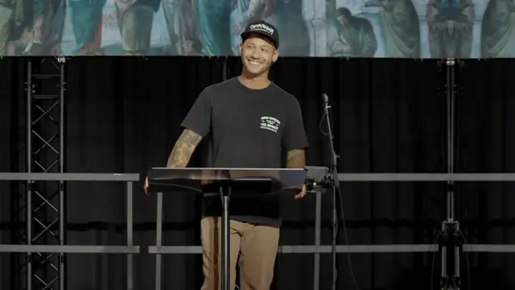{ loading=lazy }
<figcaption><strong>MLS, medium long shot.</strong> Knees up. Also called a <strong>knee shot</strong>.</figcaption>
</figure>

<figure markdown>
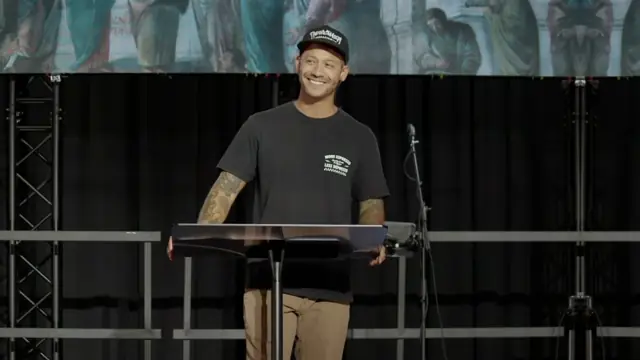{ loading=lazy }
<figcaption><strong>Cowboy shot.</strong> Mid-thigh up.</figcaption>
</figure>

<figure markdown>
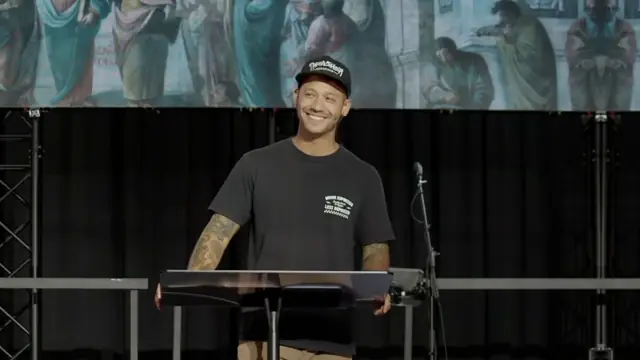{ loading=lazy }
<figcaption><strong>MS, medium shot.</strong> Waist up.</figcaption>
</figure>

<figure markdown>
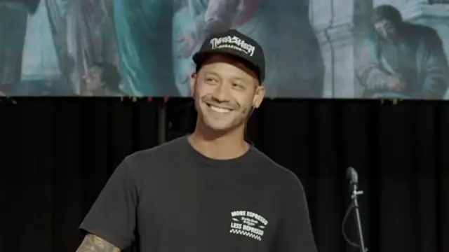{ loading=lazy }
<figcaption><strong>MCU, medium close-up.</strong> Chest up.</figcaption>
</figure>

<figure markdown>
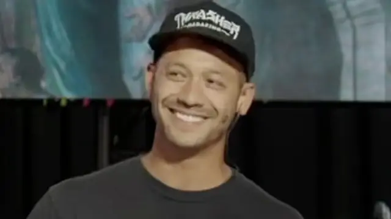{ loading=lazy }
<figcaption><strong>CU, close-up.</strong> Head and shoulders.</figcaption>
</figure>

<figure markdown>
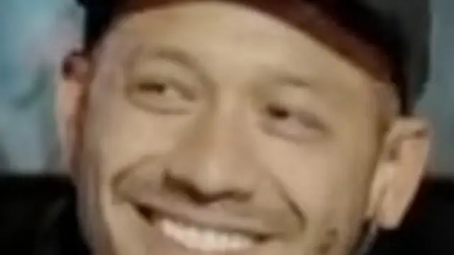{ loading=lazy }
<figcaption><strong>ECU, extreme close-up.</strong> Eyes and mouth.</figcaption>
</figure>

Two wider sizes don't fit in this photo, because the camera that took it couldn't see the speaker's feet:

- **WS, wide shot**, also called a **full shot**. Head to toe, with a little floor under the shoes.
- **EWS, extreme wide shot**. The whole stage or the whole room. The speaker is small, and the shot shows where we are.

From widest to tightest, the order is EWS, WS, MLS, cowboy, MS, MCU, CU, ECU.

!!! note "Names change from place to place"
    These are the common names, but not everyone uses them the same way. Some people call the knees-up shot an **American shot**, and some use that name for the cowboy shot instead. The cowboy shot got its name from westerns, where it's just low enough to show the gun on the hip. You'll sometimes hear a waist-up shot called a cowboy shot too. Strictly, a cowboy shot ends at mid-thigh, which is close to a knees-up shot, and a waist-up shot is a medium shot. If you're not sure what someone means, ask "Where do you want the bottom of the frame?"

!!! tip "Our house shots"
    **Main camera today: knees up, centered.** That's a medium long shot with the speaker in the middle of the frame and a little room above the head. It's wide enough that the speaker can take a step or two without walking out of the shot, which matters because nobody is following them yet.

    **Coming soon, with tracking: waist up, centered.** Once the camera can follow the speaker, it can safely go tighter, to a medium shot.

## Headroom

**Headroom** is the space between the top of the head and the top of the frame. Too much and the speaker looks like they're sinking out of the picture. Too little and they look squashed against the top. Cutting off the top of the head by accident looks like a mistake.

<figure markdown>
{ loading=lazy }
<figcaption><strong>Right.</strong> A little space above the head, eyes near the top third line.</figcaption>
</figure>

<figure markdown>
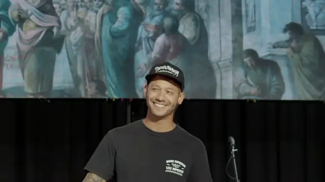{ loading=lazy }
<figcaption><strong>Too much.</strong> Tilt down.</figcaption>
</figure>

<figure markdown>
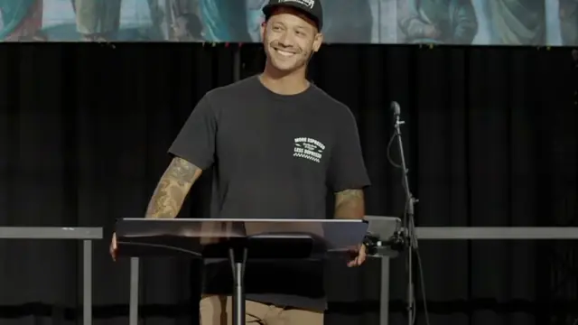{ loading=lazy }
<figcaption><strong>Cut off.</strong> Tilt up.</figcaption>
</figure>

Headroom gets smaller as the shot gets wider. In a knees-up shot, leave a sliver of space, a few percent of the frame. In a close-up, it's normal to trim a little off the top of the head, but never cut off the chin.

Many cameras can show framing guides on their screen, such as a grid or a line near the top. If yours can, set a top line where the top of the head should sit for your shot, and line the head up with it. Every camera using the same guide makes the cameras match.

## Eye line and the rule of thirds

Picture the frame split into thirds by two lines across and two lines down, like a tic-tac-toe board. This is the **rule of thirds**, and most cameras can draw that grid for you.

For a medium shot and tighter, put the speaker's **eyes on or near the top line**. People look at eyes first, and that line is a comfortable place for them. If you get the eyes right, the headroom is usually right too. In wider shots the eyes end up above that line, and that's fine. Watch the space above the head instead.

## Centered or on a third

A speaker talking to the whole room is the one thing in the shot that matters, and they look all around the room as they talk. So for a speaker, **center them**. It's also easier to keep a moving speaker in a centered shot.

Put the speaker on a third when they turn and talk to one side of the room for a while, when they're talking with someone else on stage, or when the director wants a side camera to look different from the main one.

## Lead room

When the speaker is on a third, leave the empty side of the frame in front of their face, on the side they're looking toward. That space is called **lead room**, and you'll also hear **look room** or **nose room**. When someone walks across the stage, lead room goes in front of them, in the direction they're walking.

<figure markdown>
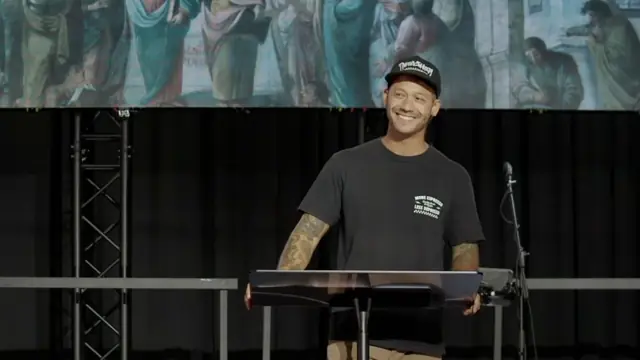{ loading=lazy }
<figcaption><strong>Lead room.</strong> He looks toward frame left, so he sits on the right third.</figcaption>
</figure>

<figure markdown>
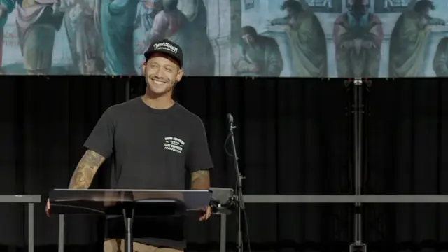{ loading=lazy }
<figcaption><strong>No lead room.</strong> He looks straight at the edge of the frame.</figcaption>
</figure>

## Don't cut at the joints

When the edge of the frame lands right on a joint, the person looks chopped off. Avoid putting the bottom or side of the frame on the **neck, elbows, waist, knees or ankles**. Cut between joints instead, such as across the chest, below the belt, at mid-thigh or just above the knees.

<figure markdown>
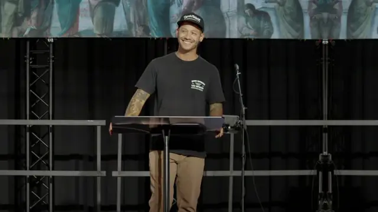{ loading=lazy width=480 }
<figcaption>The bottom edge is right on the knees. Go a little tighter or a little wider.</figcaption>
</figure>

## Keep it level

The horizon, the stage edge and the rails behind the speaker should run straight across the frame. A tilted shot looks like the camera got bumped. Check the tripod's bubble level during setup, and glance at a straight line in the background after you move the camera.

## Leave room for lower thirds

A **lower third** is the graphic near the bottom of the screen with the speaker's name, a scripture reference or an announcement. Ours sit at the bottom center of the frame, with space on both sides, so a centered speaker is right behind them.

Before a lower third goes up, make sure the speaker's chin is above it. In a medium shot it usually is. In a close-up the graphic can land on the chin or mouth, so pull out a little before it goes up, or, if you're live, wait for the director.

## Smooth moves

Everything you do while your camera is live is on the stream.

- Move slowly and steadily. Start each move gently and finish it gently, so the picture never lurches.
- Small, slow corrections while live are fine. A speaker drifts and you follow.
- Wait until you're **clear** to make a big change, like going from a wide shot to a close-up. Then make the change quickly, check focus, and **settle** before the director comes back to you.
- When you finish a move, hold still. A shot that keeps creeping looks restless.

## What directors say

Many teams use the calls below. They're common across the industry, but the words change from team to team. **Our team is still settling on its own calls**, so treat this as a starting vocabulary and expect it to change.

| Call | What it means | What you do |
|---|---|---|
| "Ready camera 1" or "Ready 1" | The director is about to put camera 1 on the stream. | Finish your move, hold your shot steady and keep it there. |
| "Take 1" | Camera 1 goes live now. | Hold your shot. Your tally light comes on. |
| "You're live", "You're hot" or "You're on" | Your camera is on the stream. | Only slow, small moves. |
| "Clear" or "You're clear" | You're not on the stream anymore. | Now is the time for big changes, focus checks and reframing. |
| "Push in" / "Pull out" | Zoom in / zoom out. | Turn the zoom slowly to a tighter or wider shot. |
| "Tighten up" / "Go wider" or "Loosen up" | Make the shot tighter / wider. | Change one shot size, like MS to MCU. |
| "Pan left" / "Pan right" | Turn the camera left or right. | Pan the camera on the tripod. |
| "Tilt up" / "Tilt down" | Point the camera up or down. | Tilt the camera on the tripod. |
| "Give him more headroom" | There isn't enough space above the head. | Tilt up a little, or pull out. |
| "More lead room" | There isn't enough space on the side they're facing. | Pan so the open space is in front of their face. |
| "Hold" or "Hold it there" | The shot is good. | Stop moving and keep it. |
| "Settle" | Finish the move and let the shot come to rest. | Make your last small correction, then stay still. |

Left and right can be confusing on a stage. **Camera left** and **camera right** are from your point of view, looking through the camera. **Stage left** and **stage right** are from the speaker's point of view, looking out at the room, so they're the other way around.

## Practice: frame the shot

The practice camera uses a photo from the main camera. Drag the picture to pan and tilt, and use the zoom to push in and pull out. The readout above the picture names the shot as you frame it, so you'll pick up the names as you go.

<iframe class="figure-embed tool-inline" src="../../../tools/framing/" title="Framing practice camera with pan, tilt and zoom, framing guides and shot calls" loading="lazy"></iframe>

  <button type="button" class="tool-launch__card" data-open-sheet="framing-sheet">
    
    Open the framing camera
  </button>

<dialog class="tool-sheet" id="framing-sheet" aria-label="Framing camera">
  

    Frame the shot
    <button type="button" data-close-sheet>Done</button>
  

  <iframe data-src="../../../tools/framing/" title="Framing practice camera with pan, tilt and zoom, framing guides and shot calls"></iframe>
</dialog>

- **Free play.** Zoom from the widest shot to an extreme close-up and watch the shot name change. Turn on the guides to see the thirds, the headroom line, the lower third and the safe areas.
- **Shot calls.** Each call starts with the camera in the wrong shot. Frame what the director asked for, then press **Director ready?** to check your work.
- **Live calls.** When the red tally light is on, you're live. Move too fast and the director will tell you to smooth it out. Try **Go live** in free play to practice.

!!! info "Why the right edge of the picture repeats"
    The speaker in this photo stands to the right of center, and the photo wasn't wide enough to center him in a knees-up shot. So the practice camera mirrors a strip of the right side of the stage to make room. If the LED wall looks mirrored at the far right, that's why.

## What to remember

- Name the shot by where the bottom of the frame lands. Knees up is an MLS, waist up is an MS, and chest up is an MCU.
- Put the eyes near the top third line in tighter shots, and leave a little room above the head in wider ones.
- Center a speaker who's talking to the whole room. Give lead room when they turn to one side.
- Never let the edge of the frame land on a joint.
- Keep the chin above the lower third.
- Move slowly while you're live, and save big changes for when you're clear.
